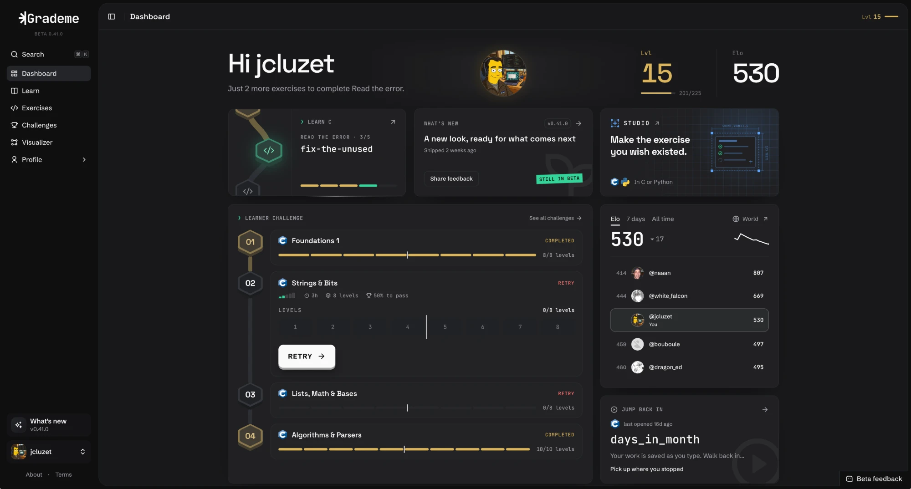

# Grademe

### Nothing beats practice to actually get better.

A real terminal, a full IDE and grading the second you hit submit, all in your browser. Write C, C++ or Python, submit, and see exactly which test failed and why, down to a missing newline.

It's free and open to everyone 👉 **[grademe.io](https://grademe.io)**

Start with **Learn C**, a path from your first program down to the system underneath, where every chapter ends on a timed checkpoint. Then take on **Challenges**: a series of exercises against one clock, level after level. Each challenge moves your Elo, every exercise you pass earns XP, and the leaderboards show where you stand.

When your code does something you don't understand, open the **Visualizer**. Step through it line by line and watch the stack, the heap and every pointer between them, with Valgrind flagging leaks and invalid memory accesses.

**GitHub sync** pushes your passing solutions to a repository you own. In **Studio** you write your own exercises and challenges with their tests, then share them with everyone. And if you'd rather stay in your terminal, the **CLI** is right here (see below).

---

### Quoi de mieux que de pratiquer pour progresser ?

Un vrai terminal, un IDE complet et une correction à la seconde où tu soumets, le tout dans ton navigateur. Tu codes en C, C++ ou Python, tu soumets, et tu vois exactement quel test a échoué et pourquoi, jusqu'au retour à la ligne oublié.

C'est gratuit et ouvert à tout le monde 👉 **[grademe.io](https://grademe.io)**

Commence par **Learn C**, un parcours qui part de ton premier programme et descend jusqu'au système, chaque chapitre se terminant par un checkpoint chronométré. Ensuite, attaque les **Challenges** : une série d'exercices contre la montre, niveau après niveau. Chaque challenge fait bouger ton Elo, chaque exercice réussi te rapporte de l'XP, et les classements te montrent où tu en es.

Quand ton code fait un truc que tu ne comprends pas, ouvre le **Visualiseur**. Tu avances ligne par ligne et tu vois la pile, le tas et chaque pointeur, avec Valgrind qui repère les fuites et les accès mémoire invalides.

La **synchro GitHub** pousse tes solutions validées sur un dépôt qui t'appartient. Dans le **Studio**, tu écris tes propres exercices et challenges avec leurs tests, puis tu les partages avec tout le monde. Et si tu préfères rester dans ton terminal, le **CLI** est juste ici (voir plus bas).



---

## Grademe in your terminal

This repository is the Grademe command line client. Same challenges, same grading, but you write the code in your own editor and submit from your terminal. Your account, your progress and the leaderboard all live on **[grademe.io](https://grademe.io)**, so sign up there first.

```sh
git clone https://github.com/JCluzet/Grademe.git
cd Grademe
make
```

You need Node.js 22 or newer. Each `make` pulls the latest version, rebuilds what changed and starts the client. The first run opens your browser to sign in with your grademe.io account.

No Node.js on your machine? Install the native build instead. It updates itself in the background:

```sh
curl -fsSL https://grademe.io/install.sh | bash
```

Pick a challenge and confirm it, the clock starts. The subject lands in `subject/subject.en.txt`. Put your files in `submission/<assignment>/`, then type `grademe` at the prompt to submit. Tests stream in as they run: pass and you move on to the next level, fail and you get the trace plus a cooldown before the next try.

The prompt is not a shell. It understands `grademe`, `status`, `workspace`, `result`, `help` and `finish`. Keep it in one tab and your editor in another. Your progress is saved on your account, so you can quit and come back later (the clock keeps running).

```sh
make ARGS="--dir ~/practice"        # write the subject and submissions somewhere else
make ARGS="--challenge <slug>"      # jump to a challenge without starting it
make ARGS="logout"                  # sign out and revoke this device
make test                           # run the test suite
```

Want every exercise, no cooldown and the full IDE in your browser? It's all on 👉 **[grademe.io](https://grademe.io)**

### En français

Clone le repo, lance `make` et connecte-toi avec ton compte [grademe.io](https://grademe.io). Il te faut Node.js 22 ou plus, sinon passe par la commande `curl` juste au dessus.

## License

[MIT](LICENSE)
